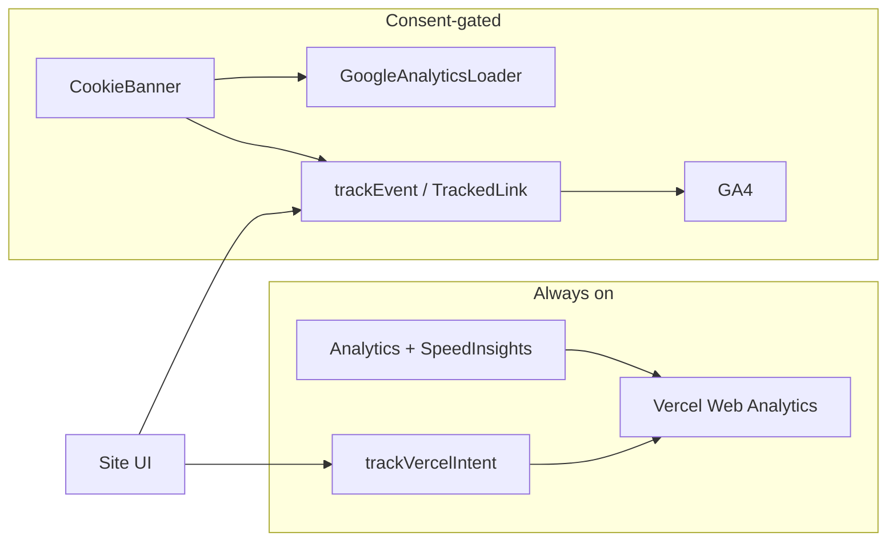

# Vercel reader analytics migration

**Status:** Specialized plan — **PR 0 (architecture & migration plan)**  
**Created:** 2026-10-17  
**Revised:** 2026-10-17  
**Location:** `docs/roadmaps/vercel-reader-analytics-migration.md`  
**Authority:** Specialized cross-layer plan. Does **not** replace [`remaining-product-roadmap.md`](remaining-product-roadmap.md). Unfinished follow-ups after each PR merge belong on the master roadmap Observe / Now sections, not as a second backlog.

**Document role:** Executable migration roadmap from Google Analytics 4 (GA4) as the primary analytics platform to **Vercel Web Analytics**, with Google Search Console retained for search discovery. The goal is a smaller, privacy-conscious system that answers questions about discovery, intellectual exploration, and meaningful readership — not feature parity with GA4.

> **Evidence rule:** Live code, schemas, tests, Vercel dashboard/API data, and production observation override planning-time snapshots in this document.

> **Safety rule:** Do not commit API tokens or credentials. Cloud Agents use PADE broker material only (`pade exec`). Do not remove GA4 until PR 3 validation is approved explicitly.

> **Stop rule:** Implementation branches are created only when that stage is ready. This document may describe all future PRs; only the current stage’s branch should exist as active work.

---

## 0. Guiding question

**Are people discovering After Certainty’s ideas, finding their way into the books, and choosing to explore further?**

Analytics inform editorial judgment. They do not substitute for it. A correctly authored source→chapter link remains valuable even when few people click it.

---

## 1. Executive summary

| Item | Decision |
|------|----------|
| Primary analytics after migration | Vercel Web Analytics (+ Speed Insights unchanged) |
| Search discovery | Google Search Console (unchanged; out of migration scope) |
| GA4 | Parallel measurement until PR 3 approval gate; retire only in PR 4 |
| New infrastructure | None — no warehouse, event DB, or third-party analytics vendor |
| Reporting | Small scripts + Cursor skill (`reader-analytics`), mirroring `ga-trends` / PADE |
| Consent stance | Document actual technology use; re-evaluate cookie banner in PR 4 |

**Feasibility:** Confirmed against live account entitlements and existing instrumentation (see §3–§4). Custom events and the aggregate Web Analytics API already work for this project.

**Largest risks:**

1. **Consent / disclosure mismatch** — Vercel Analytics is always-on today while the privacy page documents only GA4.
2. **Aggregate-only honesty** — Vercel APIs provide counts and visitors, not session-level journeys; reports must not invent funnels they cannot measure.
3. **Property budget** — Base Pro allows 2 custom properties; Web Analytics Plus (currently enabled, $10/mo) allows 8. Schemas must degrade safely if Plus is disabled.
4. **Anomalous traffic** — Recent data shows Singapore-heavy desktop traffic on research surfaces; treat as heuristic classification, never silent exclusion.
5. **Cost** — Every pageview and custom event is billed on Pro; prefer meaningful actions over indiscriminate click tracking.

---

## 2. Outcomes we care about

| # | Question | Primary measurement approach |
|---|----------|------------------------------|
| 1 | How do people discover After Certainty? | Vercel visits: `referrerHostname`, country, device, UTM (Plus); GSC for queries/rankings |
| 2 | Which research sources and thinker pages attract visitors? | Visits by `requestPath` / `route` for `/explore/sources/*`, `/explore/thinkers/*` |
| 3 | Do visitors follow links from sources and thinkers into books? | Custom `corpus_navigation` (type edges) + path aggregates for book/chapter routes |
| 4 | Which books and chapters are opened? | Custom `chapter_open` + book/chapter path pageviews |
| 5 | Are readers continuing into subsequent chapters? | Custom `chapter_advance` event **counts** vs `chapter_open` counts (ratio of aggregates — not session conversion) |
| 6 | Downloads or chapter audio? | Custom `book_download`, `reader_audio_started` |
| 7 | Do questions, trails, and search help? | Custom `reading_path_started`; search events with buckets only; path pageviews |
| 8 | Plausible human vs anomalous traffic? | Heuristic report slices: country × device × path family × referrer emptiness |

**Explicit non-claims:**

- Do not claim session-level conversion, retention, or user journeys from aggregate event counts alone.
- Do not derive exact “completion rates” unless the data model supports them (it currently does not).
- Distinguish **event counts** from **unique visitors** in every report section.

---

## 3. Current architecture (verified 2026-10-17)

| Layer | Paths | Behavior |
|-------|-------|----------|
| GA4 load | `apps/site/components/analytics/google-analytics.tsx`, `apps/site/app/layout.tsx` | Production only; preview opt-in via `NEXT_PUBLIC_GA_ENABLE_PREVIEW`; Consent Mode deny-until-Accept |
| GA4 events | `apps/site/lib/analytics/events.ts`, `track.ts`, `track-reader.ts`, `track-books-catalog.ts` | Rich taxonomy; IDs and buckets only; never manuscript text or raw queries |
| Vercel | `<Analytics />` + `<SpeedInsights />` in layout; `apps/site/lib/analytics/vercel-intent.ts` | Always mounted; custom intents via `track()` with try/catch isolation |
| Consent | `apps/site/lib/consent/*`, `apps/site/components/consent/*` | Cookie `ac_cookie_consent`; gates GA only |
| CSP | `apps/site/lib/security/headers.ts` | Allows GA hosts + `va.vercel-scripts.com` + `vitals.vercel-insights.com` |
| Privacy copy | `apps/site/app/privacy/page.tsx` | Documents GA4 only — **omits Vercel Analytics / Speed Insights** |
| GA reporting | `apps/site/.cursor/skills/ga-trends/`, `tools/ga_trends_brief.py`, `apps/site/scripts/ga4-*.sh` | PADE capability `google-analytics.read` |
| Vercel diagnostics | `apps/site/.cursor/skills/vercel-diagnostics/` | PADE capability `vercel.diagnostics` (CLI whoami/ls/inspect/logs) |

### Environment separation (preserve)

| Environment | GA4 | Vercel Analytics |
|-------------|-----|------------------|
| `next dev` (`NODE_ENV !== production`) | Off | Script present; platform typically ignores non-deploy traffic |
| Vercel preview | Off unless `NEXT_PUBLIC_GA_ENABLE_PREVIEW` | Collected under `environment=preview` (filterable in API) |
| Vercel production | On (consent-gated events) | On |

---

## 4. Confirmed Vercel entitlements and constraints

Live probe via PADE (`vercel.diagnostics`) against team `ksteffes-projects` / project `after-certainty` (`prj_RgOjCRadnw2ILa8vK9jy4GqipdLl`):

| Fact | Evidence |
|------|----------|
| Plan | **Pro** |
| Web Analytics Plus | **Enabled** (~$10/mo `invoiceItems.analytics`) |
| Custom event properties | **Up to 8** with Plus; **2** on base Pro |
| Value types | `string`, `number`, `boolean`, `null`; no nested objects |
| Name/key/value length | ≤ 255 characters each |
| Reporting window | **24 months** with Plus (12 months base Pro; 1 month Hobby) |
| Event pricing | Metered on Pro (~$0.03 per 1K events per [Vercel docs](https://vercel.com/docs/analytics/limits-and-pricing)); pageviews + custom events both count |
| Aggregate API | `GET /v1/query/web-analytics/visits/{count,aggregate}` and `…/events/{count,aggregate}` — works with broker token |
| Recent volume (approx.) | ~1.7k visitors / ~6.2k pageviews since mid-May 2026; custom events still sparse (~11 lifetime at probe time) |
| Anomaly signal (30d probe) | **SG ~830 visitors** vs **US ~91**; empty `referrerHostname` dominates |

**Design rule:** Prefer ≤2 properties per custom event so schemas remain valid if Plus is disabled. Use additional properties only when a primary outcome requires them, and document the Plus dependency.

**API honesty:** Aggregate endpoints return `count` / `pageviews` and `visitors`. They are **not** a session journey database. Multi-step “funnels” in reports must be framed as **comparable aggregate ratios**, not per-visitor paths.

---

## 5. Event inventory and classification

### 5.1 Already on Vercel (custom)

| Event | Properties | Source | Classification |
|-------|------------|--------|----------------|
| `corpus_navigation` | `from_type`, `to_type`, `relation` (3) | `CorpusNavigationRegion` → `trackVercelIntent` | **Retain** (Plus-dependent 3-prop shape; see fallback in §6) |
| `listen_item_selected` | `location`, `method` | Listen library | **Retain** (secondary; keep for Listen UX) |
| `listen_started` | `location`, `media_type` | Chapter audio player | **Consolidate** → facade name `reader_audio_started` in PR 1 |

Automatic Vercel pageviews, referrers, geo, device, browser, route, and UTM (Plus) are **retain** as the discovery/traffic backbone.

### 5.2 GA4 events — primary reader vocabulary

| GA4 event | Wired? | Destination today | Classification for Vercel migration |
|-----------|--------|-------------------|-------------------------------------|
| `chapter_open` | Yes — `RecordChapterOpen` | GA4 | **Retain** → dual-write as `chapter_open` |
| `next_chapter` | Yes — adjacent nav Next | GA4 | **Retain** → dual-write as `chapter_advance` (GA name kept during parallel run) |
| `file_download` | Yes — reader + overview | GA4 | **Retain** → dual-write as `book_download` (subset: book formats) |
| `question_path_start` / `trail_path_start` | Yes | GA4 | **Consolidate** → `reading_path_started` |
| `search_*` (open/query/select/refine/no_results/expand) | Yes | GA4 | **Investigate** for PR 1 minimal port (buckets only) vs path aggregates |
| `select_content` | Yes — Observatory / detail | GA4 | **Consolidate** — path aggregates + corpus edges often enough |
| `click` (outbound) | Yes — many CTAs | GA4 | **Investigate** — keep on GA during parallel; Vercel may not need parity |
| `page_view` | Consent Accept + Enhanced Measurement | GA4 | **Retire** on Vercel side (automatic visits) |

### 5.3 GA4 events — secondary / catalog / game

| Area | Events | Classification |
|------|--------|----------------|
| Books catalog | `books_catalog_view`, shelf/filter/sort/card selects | **Consolidate** → path aggregates; card select optional later |
| Books helpers unwired | `books_search`, `books_no_match`, `books_start_here_select` | **Retire** (dead helpers) unless wired for a real need |
| Editions / overview | edition notice/select; overview primary/concept/related/history | **Consolidate** |
| What’s New | `whats_new_*` | **Consolidate** |
| Questions extras | section view, stop open, related, continue book, observatory | **Consolidate**; keep path-start in primary vocab |
| Questions dead | `question_path_complete` (typed, no callers); `question_select` / `question_search_handoff` mostly unwired | **Retire** or wire only if Observe demand |
| Trails extras | select, stop, related, continue, handoff, observatory | **Consolidate** |
| Pattern Recognition game | `game_started`, challenge_*, `session_*` | **Investigate** — keep GA during parallel; Vercel port only if game Observe needs it |

### 5.4 Neither system today

| Gap | Notes |
|-----|-------|
| App-side bot / anomaly tagging | No `beforeSend` filters, honeypots, or custom “suspicious” events |
| Entity IDs on corpus edges | Vercel sends types only (`source`→`chapter`), not `source_id` / `book_id` |
| Session journeys | Unavailable on Vercel aggregate API by design |
| Privacy disclosure for Vercel | User-facing copy missing |

### 5.5 Coverage vs product questions

| Question | Today | Gap for Vercel-primary |
|----------|-------|------------------------|
| Discovery | GA + Vercel visits/referrers/UTM | Channel taxonomy in reports; GSC remains separate |
| Sources / thinkers | Path pageviews + type edges | Optional entity IDs (investigate); paths often enough |
| Source/thinker → books | `corpus_navigation` types | No IDs on edges; path co-occurrence is approximate |
| Books / chapters opened | GA `chapter_open` | Dual-write required |
| Continuation | GA `next_chapter` | Dual-write; report as aggregate ratio |
| Downloads / audio | GA downloads; Vercel listen | Dual-write downloads; align audio name |
| Questions / trails / search | Mostly GA | Minimal Vercel path-start + optional search buckets |
| Anomalous traffic | Platform filters only | Heuristic report slices (SG × desktop × research paths) |

---

## 6. Proposed minimal event schema

### 6.1 Primary vocabulary (PR 1)

Components call a **typed facade** (provider-agnostic). During parallel measurement the facade dual-writes: GA4 via existing consent-gated helpers, Vercel via `track()` / `trackVercelIntent`.

| Canonical name | Reconciles with | Vercel properties (prefer ≤2) | Purpose |
|----------------|-----------------|------------------------------|---------|
| `corpus_navigation` | existing Vercel event | Keep `from_type`, `to_type`, `relation` under Plus; **fallback** if Plus lost: `edge` (`source>chapter`) + `relation` | Graph navigation including source/thinker → book/chapter |
| `chapter_open` | GA `chapter_open` | `book_id`, `chapter_id` | Chapter opened |
| `chapter_advance` | GA `next_chapter` | `book_id`, `from_chapter_id` (encode `to` in a second prop only if needed) | Continue to next chapter |
| `book_download` | GA `file_download` (book formats) | `book_id`, `format` | Download EPUB/PDF/DOCX/etc. |
| `reader_audio_started` | Vercel `listen_started` | `location`, `media_type` | Chapter audio started |
| `reading_path_started` | GA `question_path_start` / `trail_path_start` | `path_kind` (`question`\|`trail`), `path_id` | Exploration path started |

### 6.2 Privacy constraints (non-negotiable)

- Never transmit manuscript text, titles as free text, summaries, raw search queries, personal information, or arbitrary URLs.
- Use normalized content types, stable IDs, and bounded enums/buckets only.
- Tracking failures must never block navigation, downloads, or playback (preserve try/catch / best-effort pattern).
- Preview vs production must remain distinguishable in queries (`environment` dimension).

### 6.3 High-cardinality avoidance

- Do not put full paths, referrer URLs, or query strings in custom properties (use automatic visit dimensions instead).
- Prefer type enums on `corpus_navigation` over per-entity IDs unless PR 3 shows path aggregates are insufficient for source→chapter editorial evaluation.
- Search (if ported): keep existing length/result/rank **buckets** only.

### 6.4 Reusable instrumentation to keep

| Path | Role in PR 1+ |
|------|----------------|
| `CorpusNavigationRegion` | Keep; route through facade |
| `RecordChapterOpen`, `ChapterAdjacentNav` | Dual-write via facade |
| Reader / overview download handlers | Dual-write book downloads |
| Chapter audio player / listen library | Align names; keep isolation |
| Question/trail path analytics beacons | Emit `reading_path_started` |
| `TrackedLink` | Remains GA-oriented during parallel run; do not duplicate blindly onto Vercel |
| Consent stack | Unchanged until PR 4 |

---

## 7. Privacy, consent, and disclosure

| Topic | Current state | Migration implication |
|-------|---------------|------------------------|
| GA4 | Consent Mode deny-until-Accept; cookie banner | Keep through PR 3 |
| Vercel Web Analytics | Always loaded; no consent gate in app code | Document as first-party / platform analytics; legal review in PR 4 |
| Speed Insights | Always loaded | Performance metrics; disclose alongside Web Analytics |
| Privacy page | GA4 only | Update disclosure when behavior is intentional (earliest honest fix may land with PR 1 docs or a small privacy PR; full banner decision in PR 4) |
| Cookie banner after GA4 retirement | Unknown | **Decide explicitly in PR 4** based on remaining tech + applicable law — do not assume cookie-free analytics eliminates every notice obligation |

---

## 8. Cost awareness

| Cost driver | Notes |
|-------------|-------|
| Pageviews | Automatic; largest volume; avoid fake SPA double-counting |
| Custom events | Each `track()` counts; keep the primary vocabulary small |
| Web Analytics Plus | ~$10/mo team add-on; enables 8 properties, 24-month window, UTM |
| Pro metered events | Roughly $0.03 / 1K events after included credit behavior — monitor Usage dashboard during parallel measurement |
| GA4 | Free tier usage today; cost of **operational complexity** and consent surface more than dollars |

**Do not** introduce a data warehouse or third-party analytics provider without a clear need and approval.

---

## 9. Reporting vision (PR 2 — documented only)

### 9.1 Cursor skill: `reader-analytics`

Follow conventions from `apps/site/.cursor/skills/ga-trends/` and `vercel-diagnostics/`:

- `SKILL.md` + companion report payload doc
- Primary auth: PADE on Cloud Agents
- Fallback: local logged-in / token workflow without committing secrets
- Propose dedicated PADE capability **`vercel.analytics.read`** (read-only Web Analytics API) rather than permanently overloading `vercel.diagnostics`
- Never echo tokens; fail loudly with helpful errors; no invented data on API failure
- Rate-limit / backoff handling

### 9.2 Suggested weekly brief sections

1. Visitors and pageviews  
2. Discovery channels and referrers (classified — see §9.3)  
3. Most visited books, chapters, sources, thinkers (`requestPath` / `route`)  
4. Source/thinker → book/chapter navigation (`corpus_navigation` aggregates)  
5. Reader continuation and downloads (event counts + visitors; ratio caveats)  
6. Audio and exploration activity  
7. Traffic anomalies (heuristic)  
8. Changes vs previous comparable period  

Timezone: document explicitly (recommend **America/Denver** for continuity with `ga-trends`, with UTC bounds stated in the brief).

### 9.3 Referrer / channel heuristics

| Class | Heuristic (illustrative) |
|-------|--------------------------|
| Organic search referral | `referrerHostname` matches known search hosts (`google.*`, etc.) |
| Social or newsletter | Known social hosts, mail app hostnames, newsletter domains |
| Other external referral | Non-empty referrer not in above sets |
| No recorded referrer | Empty `referrerHostname` |
| Suspicious / automated-looking | Concentrated geo (e.g. SG) + desktop + research/thinker path family + empty referrer + low engagement custom events — **heuristic only** |

Never silently drop classified traffic from headline totals; show it as a breakdown.

### 9.4 Scripts

Small Python and/or shell clients (repo-local) producing Markdown and optional JSON. Unit-test formatting and client error paths offline. Prefer Make / mise entrypoints consistent with `ga-trends-test`.

---

## 10. Validation strategy and migration gates

### Gate 0 — Architecture plan (this PR)

- Inventory and schema reviewed
- Entitlements and property limits documented
- No production analytics behavior change

### Gate 1 — Instrumentation

- Core events fire once per intended action
- GA4 still works
- Vercel payloads respect property limits
- Automated tests pass
- Production verification instructions included

### Gate 2 — Reporting

- Weekly brief from **real** Vercel data
- Limitations section mandatory
- Skill documents run/interpret steps
- Client + formatter tests

### Gate 3 — Parallel measurement (**mandatory approval**)

Observation window: **2–4 weeks** of production data after PR 1 is live (extend if traffic is too sparse).

Compare (directional, not exact numeric parity):

- Google-referred visits  
- Reader actions recorded  
- Chapter opens / continuation  
- Downloads  
- Source→chapter navigation  
- Geography and anomalous traffic  
- Event collection gaps  
- Privacy / consent differences  
- Reporting usefulness  
- Unexpected costs  

Deliver a **decision report** covering:

1. What Vercel measures reliably  
2. What differs from GA4  
3. What would be lost by retiring GA4  
4. Whether remaining gaps matter to After Certainty  
5. Cost outcomes  
6. Explicit recommendation: retire GA4 / corrective PR / keep parallel longer  

**Do not start PR 4 without explicit human approval of this report.**

### Gate 4 — Retire GA4

Only after Gate 3 approval. Remove GA runtime completely; update privacy, CSP, env, skills, PADE, tests, docs. Document rollback (re-enable GA loader + measurement ID + Consent Mode from git history / prior release).

---

## 11. PR sequence

| PR | Branch | Base | Deliverables | Behavior change? |
|----|--------|------|--------------|------------------|
| **0** | `docs/vercel-reader-analytics-migration` | `main` | This plan + roadmap index registration | **No** |
| **1** | `feat/vercel-reader-instrumentation` | latest `main` after PR 0 merges | Typed facade; dual-write primary events; tests; verification notes | Yes (additive) |
| **2** | `feat/vercel-reader-analytics-reporting` | latest `main` after PR 1 merges | API client, brief scripts, `reader-analytics` skill, tests | Reporting only |
| **3** | `test/vercel-reader-analytics-parity` | latest `main` after PR 2 merges | Validation artifacts + decision report | Docs/artifacts; no GA removal |
| **4** | `chore/retire-ga4` | latest `main` after PR 3 **approved** | Remove GA4; privacy/CSP/consent decision; skill cleanup | Yes (destructive) |

### Branch discipline

1. One focused branch per stage.  
2. Never commit directly to `main`.  
3. Start each implementation branch from latest `main` after the prerequisite merges.  
4. Avoid long-lived divergent branches.  
5. Do not combine stages into one enormous PR.  
6. Do not merge PRs automatically.  
7. Do not begin destructive work without approval.  
8. Include tests, manual verification, and rollback notes in each PR.  
9. Use GitHub CI and Vercel preview deployments for verification.  
10. Report blockers rather than weakening tests or silently changing scope.

### PR 1 acceptance criteria (preview)

- Core reader events fire once per intended action  
- Existing GA4 functionality preserved  
- Vercel custom-event payloads satisfy plan limits  
- Automated tests pass  
- Production verification instructions included  
- Validate source→chapter and thinker→chapter links from semantic enrichment still emit `corpus_navigation` once  

### PR 2 acceptance criteria (preview)

- Reporting script generates a useful weekly brief from real Vercel data  
- Reports explain limitations  
- Cursor skill documents how to run and interpret reports  
- API client and formatting logic have tests  
- GA4 remains operational  

### PR 3 acceptance criteria (preview)

- Decision report addresses all six questions in Gate 3  
- Gaps either accepted or routed to a corrective PR  
- Explicit approval recorded before PR 4  

### PR 4 acceptance criteria (preview)

- No GA4 runtime network requests  
- Vercel Web Analytics and Speed Insights continue  
- Reader events remain functional  
- Privacy disclosures match implementation  
- No unnecessary GA credentials/runtime config  
- Relevant tests pass  
- Rollback plan documented  
- Historical GA reporting artifacts preserved as **legacy** where useful (`ga-trends` marked legacy or archived)  

---

## 12. Rollback plans (by stage)

| Stage | Rollback |
|-------|----------|
| PR 0 | Revert docs PR |
| PR 1 | Revert instrumentation PR; GA4 path unchanged by design — dual-write can be feature-flagged or removed while leaving GA helpers intact |
| PR 2 | Disable/ignore reporting scripts and skill; no production reader impact |
| PR 3 | Documentation only |
| PR 4 | Revert merge or redeploy prior release; restore GA measurement ID, Consent Mode defaults, CSP GA hosts, and `GoogleAnalyticsLoader` from git |

---

## 13. Out of scope

- Replacing Google Search Console  
- Building a custom event warehouse or dashboard product  
- Exact numeric parity between GA4 and Vercel  
- Profiling individual readers or reconstructing personal histories  
- Blocking or excluding visitors based on geo heuristics  
- Marketing attribution / ad conversion pipelines  

---

## 14. File map (implementation reference)

| Concern | Paths |
|---------|-------|
| Layout wiring | `apps/site/app/layout.tsx` |
| Event vocabulary | `apps/site/lib/analytics/events.ts` |
| GA send path | `apps/site/lib/analytics/track.ts`, `track-reader.ts` |
| Vercel intents | `apps/site/lib/analytics/vercel-intent.ts` |
| UI beacons / regions | `apps/site/components/analytics/*`, reading/listen/paths components |
| Consent | `apps/site/lib/consent/*`, `apps/site/components/consent/*` |
| Site config / GA gates | `apps/site/lib/site-config.ts`, `apps/site/.env.example` |
| Privacy | `apps/site/app/privacy/page.tsx` |
| CSP | `apps/site/lib/security/headers.ts` |
| GA skill / scripts | `apps/site/.cursor/skills/ga-trends/`, `apps/site/scripts/ga4-*.sh`, `tools/ga_trends_brief.py` |
| PADE | `pade.yaml`, `.pade/agent-bindings.yaml` |
| Verify docs | `apps/site/docs/seo-analytics-verification.md` |

---

## 15. Immediate next step

After this PR (PR 0) is reviewed and merged:

1. Open **PR 1** on `feat/vercel-reader-instrumentation` from latest `main`.  
2. Implement the typed facade and dual-write for the six primary events.  
3. Do **not** start PR 2–4 until their prerequisites and gates are satisfied.

---

## Revision history

| Date | Change |
|------|--------|
| 2026-10-17 | PR 0: initial architecture, inventory, schema, gates, and PR sequence from live code + Vercel entitlement probe |
